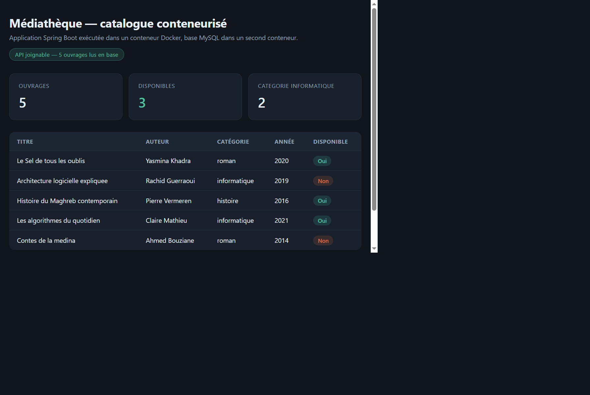
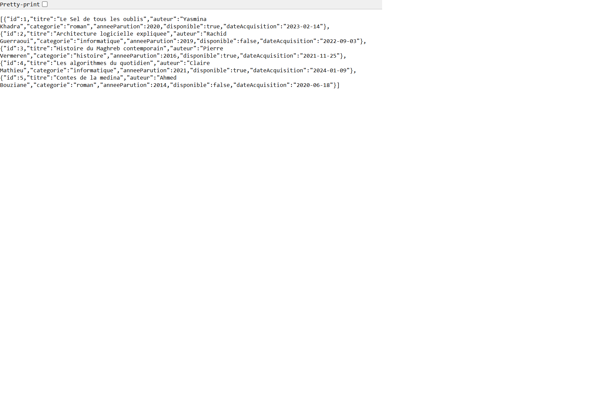
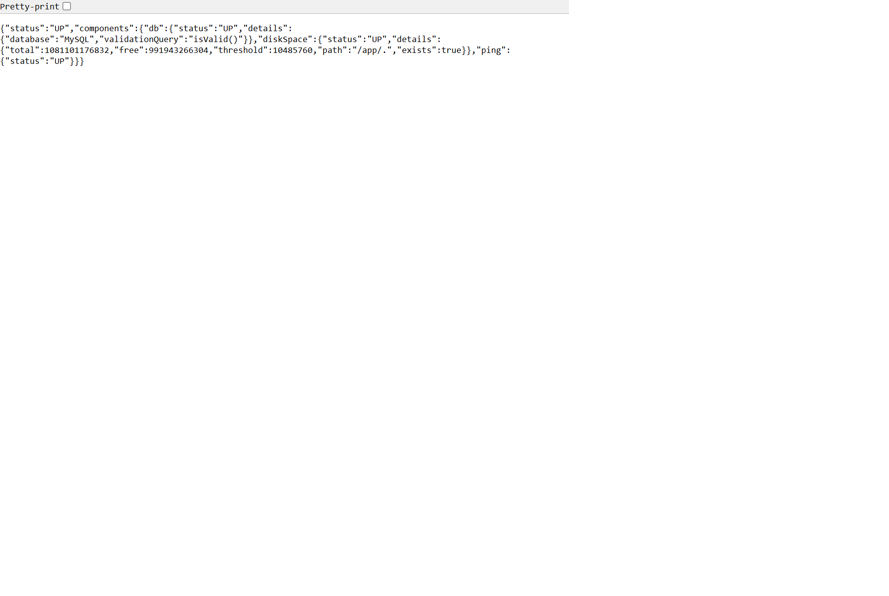
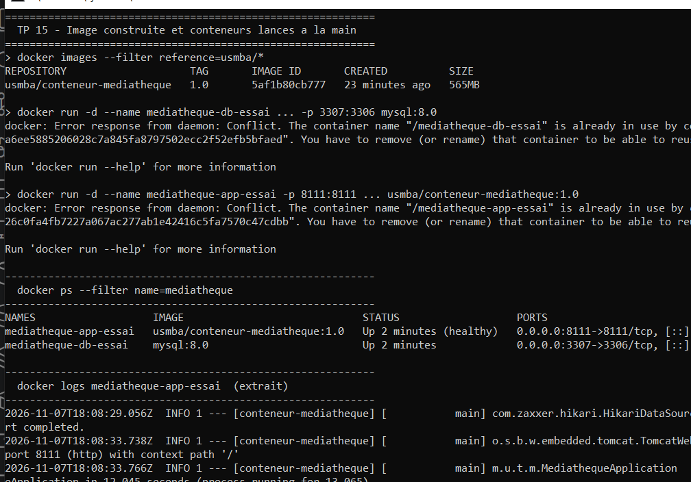
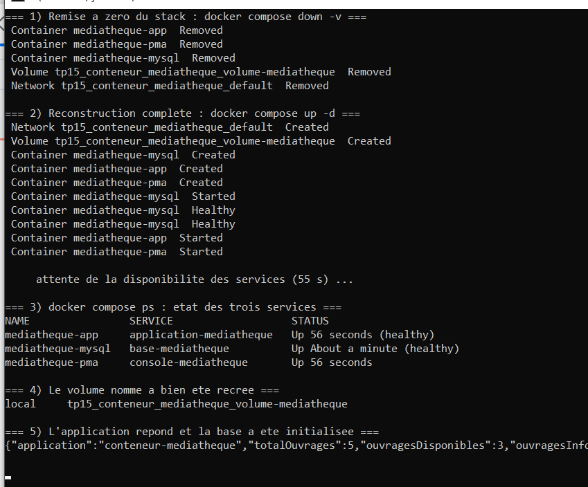
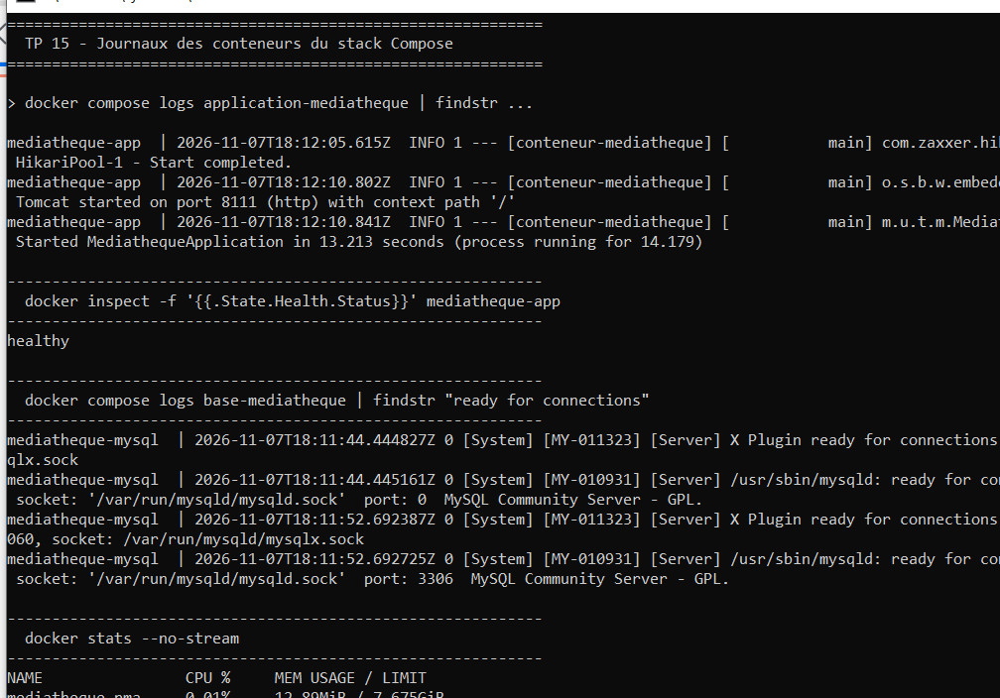
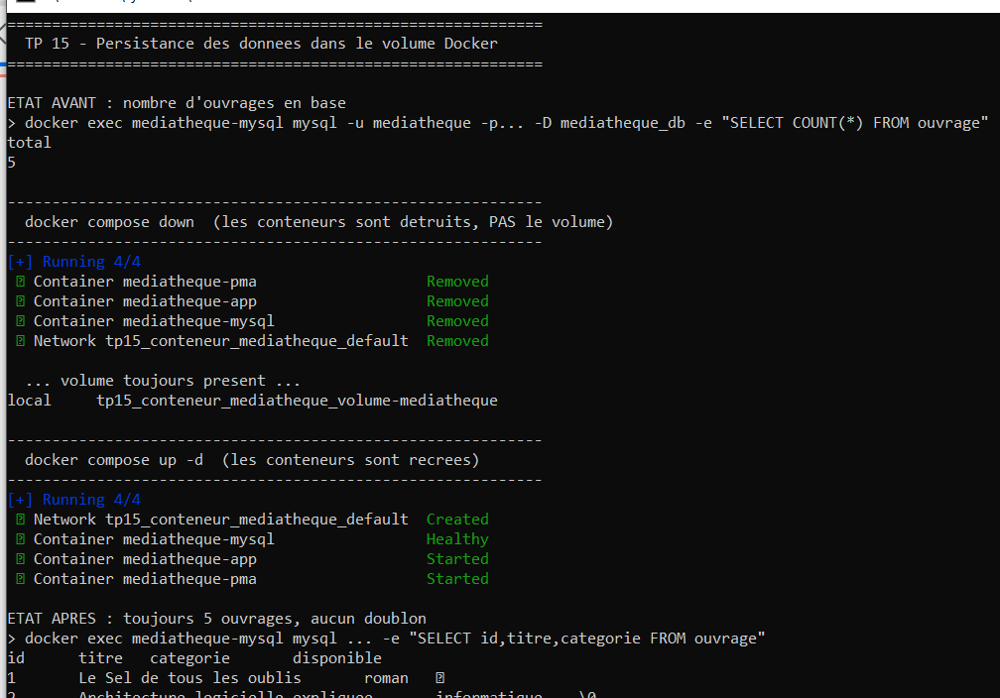
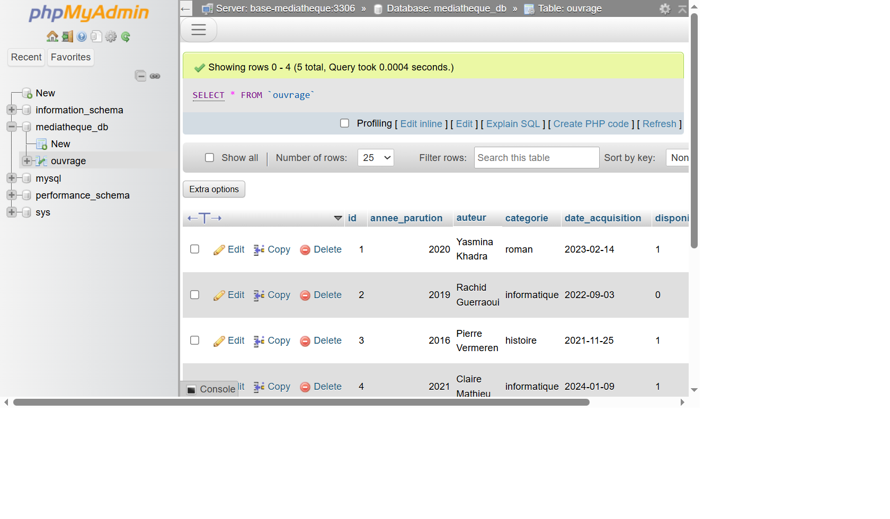

# TP 15 — Conteneurisation avec Docker

Projet **conteneur-mediatheque** : un catalogue de médiathèque exposé par une API Spring Boot,
emballé dans une **image Docker** puis déployé avec **Docker Compose** aux côtés d'une base
MySQL et d'une console phpMyAdmin.

Le but pédagogique du TP est de couvrir toute la chaîne de conteneurisation : écrire un
`Dockerfile` multi-étapes, construire l'image, lancer les conteneurs à la main avec
`docker run` (réseau, volume, variables d'environnement, publication de ports), puis
industrialiser le déploiement avec un `docker-compose.yml` et un `Makefile`. La dernière
étape démontre la **persistance des données** : le volume nommé survit à un
`docker compose down` et les ouvrages sont toujours là au redémarrage.

## Ce que fait l'application

| Élément | Rôle |
|---|---|
| `Ouvrage` (entité JPA) | un ouvrage : titre, auteur, catégorie, année, disponibilité, date d'acquisition |
| `OuvrageDepot` | repository Spring Data avec recherches dérivées par catégorie et par disponibilité |
| `CatalogueService` | amorce 5 ouvrages au démarrage (`@PostConstruct`), de façon **idempotente** |
| `CatalogueController` | 5 points d'entrée REST sous `/api/catalogue` |
| `index.html` | tableau de bord sombre qui consomme l'API |
| Spring Boot Actuator | `/actuator/health` : cible du `HEALTHCHECK` du `Dockerfile` |

Points d'entrée REST :

- `GET /api/catalogue/ouvrages` — tout le catalogue
- `GET /api/catalogue/ouvrages/{id}` — un ouvrage (404 s'il n'existe pas)
- `GET /api/catalogue/categories/{categorie}` — filtre par catégorie (`roman`, `informatique`, `histoire`)
- `GET /api/catalogue/disponibles` — uniquement les ouvrages disponibles
- `GET /api/catalogue/synthese` — compteurs utilisés par le tableau de bord

## Données de démonstration

| Titre | Auteur | Catégorie | Année | Disponible |
|---|---|---|---|---|
| Le Sel de tous les oublis | Yasmina Khadra | roman | 2020 | oui |
| Architecture logicielle expliquee | Rachid Guerraoui | informatique | 2019 | non |
| Histoire du Maghreb contemporain | Pierre Vermeren | histoire | 2016 | oui |
| Les algorithmes du quotidien | Claire Mathieu | informatique | 2021 | oui |
| Contes de la medina | Ahmed Bouziane | roman | 2014 | non |

L'amorçage vérifie `depot.count() > 0` avant d'insérer : au deuxième démarrage sur le même
volume, rien n'est dupliqué. C'est ce qui rend la démonstration de persistance lisible.

## Les fichiers Docker

| Fichier | Rôle |
|---|---|
| `Dockerfile` | construction **multi-étapes** : stage `construction` (`maven:3.9-eclipse-temurin-17`) qui compile le JAR, puis stage d'exécution (`eclipse-temurin:17-jre-jammy`) allégé |
| `docker-compose.yml` | 3 services (`base-mediatheque`, `application-mediatheque`, `console-mediatheque`) + 1 volume nommé |
| `.dockerignore` | exclut `target/`, `docs/`, `.git/`, `Makefile` du contexte de construction (image plus légère et build reproductible) |
| `Makefile` | raccourcis `make image`, `demarrer`, `etat`, `logs`, `arreter`, `nettoyer` |

Points techniques du `Dockerfile` :

- **Multi-stage** : le JDK et Maven (≈ 500 Mo) ne partent pas dans l'image finale ; seule la JRE est embarquée.
- **Cache de dépendances** : `COPY pom.xml` puis `dependency:go-offline` **avant** `COPY src`, donc un changement de code ne re-télécharge pas les dépendances.
- **Utilisateur non privilégié** : `groupadd`/`useradd mediatheque` puis `USER mediatheque` — l'application ne tourne pas en `root`.
- **`HEALTHCHECK`** sur `/actuator/health` (`--start-period=45s`), ce qui donne l'état `(healthy)` visible dans `docker ps`.
- **`EXPOSE 8111`** et `ENTRYPOINT ["java","-jar","app.jar"]`.

## Prérequis

- **Docker Desktop** (moteur Linux) avec le plugin `docker compose` v2
- `make` (facultatif — toutes les cibles existent aussi en commandes `docker` brutes)
- Un navigateur pour les écrans de vérification

## Construire et lancer

### 1. Construire l'image

```bash
docker build -t usmba/conteneur-mediatheque:1.0 .
# ou
make image
```

### 2. Lancer la pile complète

```bash
docker compose up -d
docker compose ps
# ou
make demarrer
```

| Service | Conteneur | Port hôte | Rôle |
|---|---|---|---|
| `base-mediatheque` | `mediatheque-mysql` | **3307** → 3306 | MySQL 8.0, base `mediatheque_db` |
| `application-mediatheque` | `mediatheque-app` | **8111** → 8111 | l'API Spring Boot |
| `console-mediatheque` | `mediatheque-pma` | **8112** → 80 | phpMyAdmin |

L'application démarre **après** que MySQL soit `healthy` (`depends_on: condition: service_healthy`)
et son URL JDBC pointe vers `base-mediatheque:3306`, c'est-à-dire le **nom du service** dans
le réseau Docker — pas `localhost`.

### 3. Vérifier

```bash
curl http://localhost:8111/api/catalogue/synthese
curl http://localhost:8111/actuator/health
```

### 4. Arrêter

```bash
docker compose down      # arrête et supprime les conteneurs, GARDE le volume
docker compose down -v   # arrête et supprime aussi le volume MySQL
```

## Résultats obtenus

### 1. Tableau de bord servi depuis le conteneur



L'application tourne dans le conteneur `mediatheque-app` et répond sur le port **8111**. Le
tableau de bord affiche les trois compteurs calculés par `/api/catalogue/synthese` — 5 ouvrages,
3 disponibles, 2 en informatique — ainsi que la liste des cinq ouvrages avec le badge de
disponibilité et la catégorie.

### 2. API REST du catalogue



`GET /api/catalogue/ouvrages` renvoie le JSON complet des cinq ouvrages, tels qu'ils sont lus
dans MySQL. C'est cette réponse que le tableau de bord consomme en JavaScript.

### 3. Sonde de santé et preuve d'exécution en conteneur



`/actuator/health` expose `"status":"UP"`, la base `"database":"MySQL"` avec sa version, et
surtout `"path":"/app/."` : le répertoire de travail est celui du conteneur, ce qui prouve
que l'application n'est pas lancée depuis la machine hôte.

### 4. Construction de l'image puis lancement manuel des deux conteneurs



Fenêtre de console réelle, dans l'ordre : `docker build` de l'image
`usmba/conteneur-mediatheque:1.0`, `docker run` du conteneur MySQL sur le port 3307,
`docker run` du conteneur applicatif sur le port 8111, puis `docker ps` qui montre les deux
conteneurs `Up` — l'applicatif avec l'état `(healthy)` remonté par le `HEALTHCHECK`.
Les journaux filtrés (`| findstr`) affichent les lignes `HikariPool-1 - Start completed`,
`Tomcat started on port 8111` et `Started MediathequeApplication in 12.045 seconds`, suivies
de la réponse JSON de `/api/catalogue/synthese`. La version texte de ces commandes est dans
[`docs/captures/02-docker-run-essai.txt`](docs/captures/02-docker-run-essai.txt), le log de
construction complet dans [`docs/captures/01-docker-build.txt`](docs/captures/01-docker-build.txt).

### 5. Cycle Docker Compose : `down -v` puis `up -d`



Le volume est supprimé (`docker compose down -v`), puis `docker compose up -d` recrée le
réseau `tp15_conteneur_mediatheque_default`, les trois conteneurs et le volume nommé.
`docker compose ps` montre les trois services ; la colonne `STATUS` passe à `(healthy)` pour
MySQL et pour l'application après la période de démarrage. Le `curl` final renvoie les mêmes
compteurs, ce qui signifie que la base a été initialisée automatiquement par l'amorçage.

### 6. Journaux et santé de la pile



`docker compose logs` montre la séquence complète : MySQL qui termine son initialisation
(`ready for connections`), puis l'application qui se connecte sur `base-mediatheque:3306`,
démarre Tomcat sur 8111 et se déclare `Started`. La commande `docker compose ps` en fin de
capture confirme les deux états `(healthy)`. L'état détaillé (services déclarés, réseau,
volume, images utilisées) est conservé dans
[`docs/captures/03-docker-compose-etat.txt`](docs/captures/03-docker-compose-etat.txt).

### 7. Persistance des données grâce au volume nommé



La démonstration procède en quatre temps. D'abord un `SELECT COUNT(*)` dans MySQL renvoie **5**
ouvrages et `docker volume inspect` affiche `volume-mediatheque` avec son point de montage
`/var/lib/mysql`. Ensuite `docker compose down` : les conteneurs et le réseau disparaissent,
mais `docker volume ls` montre que `tp15_conteneur_mediatheque_volume-mediatheque` est
**toujours présent**. Puis `docker compose up -d` relance la pile, et un second `SELECT` sur
`id`, `titre`, `categorie`, `disponible` renvoie exactement les mêmes cinq lignes, sans
doublon. Le `curl` final sur `/api/catalogue/synthese` retourne toujours `totalOuvrages: 5`.
C'est l'illustration qu'un conteneur est éphémère mais qu'un **volume nommé** conserve les
données.

### 8. Contrôle direct de la table dans phpMyAdmin



phpMyAdmin est ajouté à la pile comme troisième service (`console-mediatheque`, port 8112) et
joint MySQL par le nom de service `base-mediatheque:3306`. La capture montre la table
`mediatheque_db.ouvrage` avec ses 5 enregistrements et la requête `SELECT * FROM ouvrage`
exécutée depuis l'interface : les données sont bien dans la base du conteneur, pas en mémoire.

## Choix d'implémentation

- **Multi-stage build** : l'image finale ne contient que la JRE et le JAR, pas Maven ni le code source.
- **Amorçage idempotent** (`if (depot.count() > 0) return;`) : indispensable pour que la
  démonstration de persistance soit crédible — sans lui, un second démarrage insérerait
  cinq nouvelles lignes et le test ne prouverait rien.
- **`HEALTHCHECK` dans l'image** et `healthcheck` sur MySQL dans le Compose : l'ordre de
  démarrage est piloté par l'état réel des services et non par un `sleep` arbitraire.
- **`depends_on: condition: service_healthy`** : l'application ne tente pas de se connecter
  à une base encore en cours d'initialisation.
- **Volume nommé** (`volume-mediatheque`) plutôt qu'un *bind mount* : portable, géré par
  Docker, et supprimable explicitement avec `-v`.
- **`restart: unless-stopped`** sur les trois services : la pile survit à un redémarrage
  du moteur Docker.
- **Configuration par variables d'environnement** : `application.properties` contient des
  valeurs par défaut pour un lancement local, et Compose écrase `SPRING_DATASOURCE_URL`,
  `SPRING_DATASOURCE_USERNAME`, `SPRING_DATASOURCE_PASSWORD` et `SERVER_PORT`. La même image
  tourne donc sans reconstruction.
- **`utf8mb4`** forcé côté MySQL (`--character-set-server=utf8mb4`) pour les accents des titres.
- **`.dockerignore`** excluant `docs/` : les captures ne partent pas dans le contexte de build.

## Personnalisation par rapport à l'énoncé

| Énoncé | Réalisation |
|---|---|
| Groupe `ma.ens` | `ma.usmba` |
| Artefact `springdocker` | `conteneur-mediatheque` |
| JAR `springdocker-0.0.1-SNAPSHOT.jar` | `conteneur-mediatheque.jar` (`finalName`) |
| Package `ma.ens.springdocker` | `ma.usmba.tp15.mediatheque` |
| Image `ens/springdocker:1.0` | `usmba/conteneur-mediatheque:1.0` |
| Conteneur `spring-app` | `mediatheque-app` |
| Port `8080` | **8111** |
| Port MySQL `3306` | **3307** |
| Base `demo_db` | `mediatheque_db` |
| Mot de passe root `1234` | `RacineMediatheque2026` |
| Service `mysql-db` / `spring-app` | `base-mediatheque` / `application-mediatheque` |
| Volume `mysql-data` | `volume-mediatheque` |
| `docker-compose` (v1) | `docker compose` (plugin v2) |
| — | service `console-mediatheque` (phpMyAdmin) ajouté |
| — | utilisateur non privilégié `mediatheque` dans l'image |
| — | `HEALTHCHECK` sur `/actuator/health` |
| — | `Makefile` de pilotage |
| Application vide | catalogue de médiathèque (JPA + MySQL + Actuator + tableau de bord) |

## Structure du projet

```
tp15_conteneur_mediatheque/
├── pom.xml
├── Dockerfile
├── docker-compose.yml
├── Makefile
├── .dockerignore
├── .gitignore
├── src/main/java/ma/usmba/tp15/mediatheque/
│   ├── MediathequeApplication.java
│   ├── modele/Ouvrage.java
│   ├── depot/OuvrageDepot.java
│   ├── service/CatalogueService.java
│   └── web/CatalogueController.java
├── src/main/resources/
│   ├── application.properties
│   └── static/index.html
└── docs/
    ├── captures/
    │   ├── 01-docker-build.txt
    │   ├── 02-docker-run-essai.txt
    │   └── 03-docker-compose-etat.txt
    └── screenshots/
        ├── 01-application-conteneur.png
        ├── 02-api-ouvrages.png
        ├── 03-health-db.png
        ├── 04-docker-images-ps-logs.png
        ├── 05-docker-compose-up.png
        ├── 06-docker-compose-logs.png
        ├── 07-persistance-volume.png
        └── 08-phpmyadmin-ouvrage.png
```
